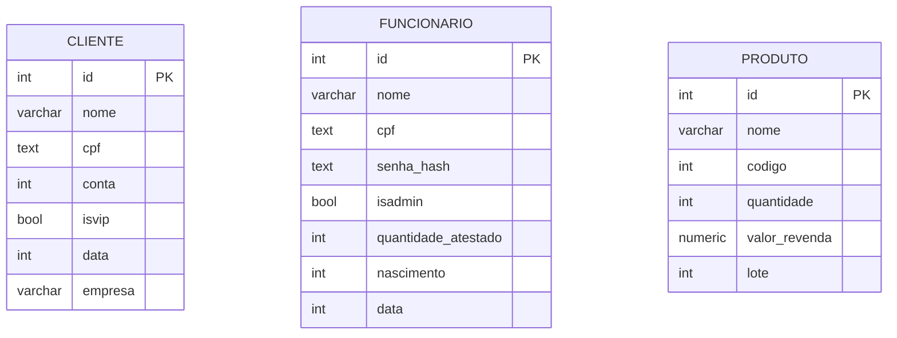

<div align="center">

# Sistema de Gestão com .NET

**API REST assíncrona para gestão de clientes, funcionários e estoque**
Autenticação JWT · RBAC · Entity Framework Core · PostgreSQL · Docker · Deploy em produção

[](https://github.com/Daniel-X2/Sistema-de-Gestao-com-DOTNET/actions/workflows/desenvolvimento.yaml)


[**API ADO.NET**](https://api-gestao-dotnet-ado.onrender.com/) · [**API EF Core**](https://api-gestao-dotnet-ef.onrender.com/) · [**Vídeo de demonstração**](https://youtu.be/g3xyDaQyCmI)

> Duas versões publicadas no Render, **usando o mesmo banco PostgreSQL no Supabase**: a branch `ADO` (ADO.NET/Npgsql) e a branch `ef` (Entity Framework Core). As diferenças da branch `ef` estão destacadas ao longo do documento.

</div>

---

## Sumário

- [Visão geral](#visão-geral)
- [Estado da branch `ef`](#estado-da-branch-ef)
- [Demonstração](#demonstração)
- [Destaques técnicos](#destaques-técnicos)
- [Tecnologias](#tecnologias)
  - [Inventário técnico (versões e pacotes)](#inventário-técnico-versões-e-pacotes)
- [Arquitetura](#arquitetura)
- [Estrutura do projeto](#estrutura-do-projeto)
- [Modelo de dados](#modelo-de-dados)
- [Funcionalidades](#funcionalidades)
- [Endpoints](#endpoints)
- [Tratamento de erros](#tratamento-de-erros)
- [Logs](#logs)
- [Testes](#testes)
- [Desempenho em produção](#desempenho-em-produção)
  - [Comparação entre deploys (ADO.NET vs EF Core)](#comparação-entre-deploys-adonet-vs-ef-core)
- [Como executar](#como-executar)
- [Deploy](#deploy)
  - [CI/CD](#cicd)
- [Autor](#autor)

---

## Visão geral

API REST construída com **ASP.NET Core (Minimal APIs)** para gerenciar **clientes**, **funcionários** e **produtos/estoque**, com painel de estatísticas para dashboard. O projeto prioriza **separação de responsabilidades**, **segurança** e **observabilidade**, e as duas versões publicadas — branch `main` (ADO.NET) e branch `ef` (EF Core) — rodam no **Render** com o **mesmo banco PostgreSQL hospedado no Supabase**.

A documentação interativa (**Swagger**) fica na raiz da URL: basta fazer login com a credencial de demonstração, copiar o token e testar os endpoints protegidos direto pelo navegador.

Nesta branch, o acesso a dados foi migrado de ADO.NET puro para **Entity Framework Core 10** com o provider **Npgsql**. A aplicação continua com a mesma arquitetura em camadas, DTOs, JWT, BCrypt e Serilog.

> **Resumo técnico:** .NET 10 / C# / ASP.NET Core Minimal APIs / EF Core 10 + Npgsql / PostgreSQL 18 no Supabase / JWT + BCrypt / Serilog / Swagger / xUnit v3 + Moq + Bogus / Docker + Docker Compose / GitHub Actions + Docker Hub / Render / Locust.

## Estado da branch `ef`

Principais diferenças em relação à branch `main`:

- **EF Core em todos os repositórios**: `ConnectHost` é um `DbContext` registrado com `AddDbContextPool` e `UseNpgsql`; consultas usam LINQ (`AnyAsync`, `FirstOrDefaultAsync`, `Skip/Take`, `ExecuteUpdateAsync`, `ExecuteDeleteAsync`).
- **Connection string via ambiente**: `DB_CONNECTION` é lido de `.env` — não há segredo de banco no código.
- **Autenticação ativa**: `UseAuthentication()` e `UseAuthorization()` estão habilitados, e os serviços de produto/dashboard estão registrados na DI.
- **Paginação efetiva nas listagens** de clientes, funcionários, produtos e estoque (`ORDER BY id LIMIT ... OFFSET ...`), com `page`/`limit` válidos por padrão.
- **`codigo` persistido no cadastro de produto**; verificação de duplicidade usa `AnyAsync`/`Count`.
- **`senha_hash` não é carregada nas listagens de funcionários**: consultas projetam apenas as colunas necessárias. O hash é lido somente no login e gravado no cadastro.
- **Autorização aplicada**: todas as rotas exceto o login exigem JWT; a listagem de funcionários exige a policy `Admin` (ver [Endpoints](#endpoints)).

### Validações locais da branch `ef`

Feitas com a API local na porta `5153` e PostgreSQL em `localhost:5433`, antes dos testes dos deploys:

- `ExistsAccount`/`ExistsCpf` corrigidos com `AnyAsync` → cadastro de cliente novo voltou a funcionar; duplicado retorna `422`.
- `First()` substituído por `FirstOrDefaultAsync` → "não encontrado" passou a responder `400`/`422` em vez de `500`.
- `AddProduct` passou a gravar o campo `codigo`; código duplicado retorna `422`.
- Paginação com `OrderBy(id).Skip/Take` nas listagens (SQL com `LIMIT/OFFSET`).
- `senha_hash` removida das consultas de listagem/`get` de funcionário.
- `Validation.cs` (cálculo do CPF) **não** foi alterado, por decisão explícita.
- Build da solution: **0 erros**.

## Demonstração

| Recurso | Link |
|---|---|
| API ADO.NET (`main`) + Swagger | https://api-gestao-dotnet-ado.onrender.com/ |
| API EF Core (`ef`) + Swagger | https://api-gestao-dotnet-ef.onrender.com/ |
| Vídeo: autenticação JWT e endpoints protegidos | https://youtu.be/g3xyDaQyCmI |

**Credencial de demonstração** (o usuário `id = 1` não pode ser removido nem atualizado pela API):

```json
{
  "cpf": "78069320036",
  "senha": "123"
}
```

**Como testar em 30 segundos:**

1. Abra o Swagger da [versão ADO.NET](https://api-gestao-dotnet-ado.onrender.com/) ou da [versão EF Core](https://api-gestao-dotnet-ef.onrender.com/)
2. Execute `POST /funcionario/login` com a credencial acima
3. Clique em **Authorize** e cole o token retornado
4. Explore os endpoints de clientes, produtos, estoque e dashboard

## Destaques técnicos

- **Arquitetura em camadas**: rotas → serviços → repositórios, com DTOs e exceções de domínio.
- **Autenticação JWT** com **RBAC** (roles `Admin` e `User`) e senhas com **BCrypt**.
- **Rate limiting** configurado (5 requisições/minuto); nesta branch o limiter ainda não foi aplicado às rotas com `RequireRateLimiting`.
- **Middleware global de exceções**: respostas JSON padronizadas e status HTTP coerentes.
- **Logs estruturados** com Serilog (console + arquivo com rotação diária).
- **Validações de domínio**: CPF (algoritmo próprio), nome, conta, código, lote, quantidade e ano de nascimento.
- **Atualização parcial**: campos inválidos mantêm o valor anterior e são devolvidos na resposta.
- **Paginação** com `Skip/Take` nas listagens de clientes, funcionários, produtos e estoque.
- **Consultas assíncronas** com EF Core, sem `First()` síncrono e sem carregar `senha_hash` em listagens.
- **Testes unitários** (xUnit, Moq, Bogus) e **testes de carga** (Locust).
- **CI** com GitHub Actions e **Docker** multi-stage com usuário não-root.
- **Dois deploys em produção** (Render + Supabase), ADO.NET e EF Core, sobre o **mesmo banco**, configurados por variáveis de ambiente, com região escolhida a partir de medições de latência e monitoramento contínuo.

## Tecnologias

| Categoria | Tecnologia |
|---|---|
| Plataforma | .NET / ASP.NET Core (Minimal APIs) |
| Banco de dados | PostgreSQL (Supabase em produção) |
| Acesso a dados | Entity Framework Core 10 com provider Npgsql 10 (LINQ + consultas assíncronas) |
| Autenticação | JWT Bearer + RBAC (Admin/User) |
| Segurança | BCrypt, Rate Limiting |
| Logs | Serilog (console + arquivo rotativo diário) |
| Configuração | DotNetEnv (variáveis de ambiente via `.env`) |
| Testes | xUnit, Moq, Bogus |
| Testes de carga | Locust |
| Infraestrutura | Docker, Docker Compose, GitHub Actions |
| Hospedagem | Render (API) + Supabase (PostgreSQL) |
| Padrões | Injeção de Dependência, Repository, Service Layer, Middleware |

### Inventário técnico (versões e pacotes)

**Linguagem / plataforma**

- C# com .NET 10 (`net10.0`) e SDK `10.0.404`
- ASP.NET Core — Minimal APIs
- Solution `Api.sln` com 3 projetos: `Api`, `Api.Core`, `Api.Test`
- `Nullable` e `ImplicitUsings` habilitados

**Arquitetura / padrões**

- Arquitetura em camadas: Routers → Services → Repositories → DbContext
- Injeção de dependência nativa (`IServiceCollection`), `AddDbContextPool` + `AddScoped`
- Repository Pattern + Service Pattern, DTOs e exceções customizadas de domínio
- `InternalsVisibleTo` (`Api.Test` e `DynamicProxyGenAssembly2`); modelo de usuário com C# `record`

**Acesso a dados**

- Entity Framework Core 10, `Npgsql.EntityFrameworkCore.PostgreSQL` 10.0.3 e `Npgsql` 10.0.3
- `Microsoft.EntityFrameworkCore.InMemory` 8.0.0 e `Microsoft.AspNetCore.Diagnostics.EntityFrameworkCore` 8.0.0
- PostgreSQL 18 (imagem `postgres:18.3-alpine3.23`); Supabase em produção
- LINQ/consultas assíncronas: `AnyAsync`, `FirstOrDefaultAsync`, `CountAsync`, `ToListAsync`, `ExecuteUpdateAsync`, `ExecuteDeleteAsync`, `Skip/Take` e projeções
- SQL de inicialização via `/docker-entrypoint-initdb.d` (`sql.sql`)

**Autenticação / segurança**

- `Microsoft.AspNetCore.Authentication.JwtBearer` 10.0.5 e `Microsoft.AspNetCore.Authentication` 2.3.9
- HS256, expiração de 2h, issuer/audience
- RBAC com policies `Admin` e `User` (`RequireRole`)
- `BCrypt.Net-Next` 4.2.0 (hash de senha)
- Rate limiting nativo: `AddRateLimiter`, política `fixed` (5 req/min)
- ASP.NET Core DataProtection; CPF como credencial de login

**Logs / observabilidade**

- Serilog 4.3.1, `Serilog.AspNetCore` 10.0.0, `Serilog.Sinks.Console` 6.1.1 e `Serilog.Sinks.File` 7.0.0 (rotação diária)

**Documentação da API**

- Swagger/OpenAPI via `Swashbuckle.AspNetCore.SwaggerGen` 6.8.1 e `Swashbuckle.AspNetCore.SwaggerUI` 6.8.1
- Esquema Bearer global e UI na raiz (`/`)

**Testes**

- xUnit v3 3.2.2 (`OutputType=Exe` / Microsoft.Testing.Platform) e `Microsoft.NET.Test.Sdk` 18.3.0
- Moq 4.20.72 e Bogus 35.6.5 (dados falsos, locale `pt_BR`, CPF)
- 29 casos executáveis; Locust para testes de carga

**Configuração**

- DotNetEnv 3.2.0 (arquivos `.env`)
- Variáveis de ambiente: `DB_CONNECTION`, `JWT_KEY`, `JWT_ISSUER`, `JWT_AUDIENCE`, `POSTGRES_PASSWORD`, `ASPNETCORE_HTTP_PORTS`, `ASPNETCORE_ENVIRONMENT`
- `appsettings.json` / `appsettings.Development.json`, `launchSettings.json` (IIS Express / perfis locais) e `UserSecretsId` declarado nos `.csproj`

**Containers / Compose**

- Docker multi-stage: build em `mcr.microsoft.com/dotnet/sdk:10.0`, runtime em `mcr.microsoft.com/dotnet/aspnet:10.0`, usuário não-root `appuser`, `dotnet publish -c release`, `EXPOSE 5153`
- `Dockerfile_db`: `postgres:18.3-alpine3.23`, `EXPOSE 5432`
- Docker Compose (sintaxe `services:`, volumes nomeados): `Compose/docker-compose.yml` (API + PostgreSQL, portas `5153` e `5433`) e `Teste Local/docker-compose.yml` (somente PostgreSQL, porta `5433`)
- Imagens no Docker Hub: `danizura/api-gestao-dotnet:EF` e `danizura/postgres_a`

**CI/CD / deploy**

- GitHub Actions em `ubuntu-latest`: `.github/workflows/docker.yaml` (build e push da imagem), `deploy.yaml` (hook de deploy) e `tests.yaml.` (build e teste — nome inválido)
- `actions/checkout@v6` (docker.yaml) e `@v3` (deploy.yaml / tests.yaml.), `actions/setup-dotnet@v4` (`10.x`), `docker/login-action@v4`, `docker/build-push-action@v7`, `actions/attest@v4`
- Secrets: `USERNAME_DOCKER`, `PASSWORD_DOCKER`, `HOOK_RENDER_EF`
- Render com 2 versões (ADO.NET e EF Core) na região Virginia; deploy disparado por webhook via `curl`

> O badge de CI no topo deste documento referencia `.github/workflows/desenvolvimento.yaml`, presente na branch `main`; nesta branch `ef` os workflows disponíveis são os listados acima.

## Arquitetura

Cada camada tem uma responsabilidade clara:

- **Routers**: definem endpoints, autorização e contrato HTTP.
- **Services**: concentram regras de negócio e validações.
- **Repositories**: isolam o acesso a dados. Nesta branch, usam LINQ sobre o `DbContext` (`ConnectHost`) em vez de SQL escrito à mão; comandos de bulk usam `ExecuteUpdateAsync`/`ExecuteDeleteAsync`.
- **Middleware**: captura exceções de qualquer camada e as converte em respostas padronizadas.
- **Infraestrutura**: `AddScope` registra o DbContext com `AddDbContextPool` e injeta repositórios/serviços; `Load.EnvConnection()` lê `DB_CONNECTION` do ambiente.

## Estrutura do projeto

```
├── .github/workflows/          # Pipeline de CI (GitHub Actions)
│
├── Api/                        # Ponto de entrada, rotas e middleware
│   ├── Application/
│   │   ├── Routers/            # Endpoints (Client, Funcionario, Product, Dashboard)
│   │   └── middleware/         # Tratamento centralizado de exceções
│   ├── Auth/                   # TokenService (JWT) e modelo de usuário
│   ├── Crypt/                  # BCrypt (hash e verificação de senha)
│   └── Program.cs
│
├── Api.Core/                   # Lógica de negócio e acesso a dados
│   └── Application/
│       ├── dto/                # DTOs (Client, Funcionario, Produto, Dashboard)
│       ├── repository/         # Repositórios com LINQ/EF Core (sem SQL escrito à mão)
│       ├── service/            # Regras de negócio e validações
│       ├── utils/              # DbContext (Conexao.cs), DI (AddScope), Validation
│       └── CustomException/    # Exceções personalizadas
│
├── Api.Test/                   # Testes unitários
│   ├── dados.cs                # Geração de dados com Bogus
│   └── Test/                   # Testes de serviço (Client, Funcionario, Product, Utils)
│
├── Compose/                    # Docker Compose geral (API + PostgreSQL)
│   ├── docker-compose.yml
│   └── sql.sql                 # Script de inicialização do banco
│
├── Teste Local/                # Docker Compose só do banco, para rodar a API localmente
│
├── Dockerfile                  # Imagem da API (multi-stage, usuário não-root)
├── Dockerfile_db               # Imagem do PostgreSQL
└── Api.sln
```

## Modelo de dados



O script `Compose/sql.sql` cria as tabelas e insere dois registros iniciais: o funcionário administrador de demonstração e um cliente de exemplo.

## Funcionalidades

### Autenticação e autorização
- Login via **CPF + senha** com geração de token **JWT**.
- Roles `Admin` (acesso total, incluindo listagem de funcionários) e `User` (acesso restrito).
- Senhas armazenadas com **BCrypt**.
- **Rate limiting**: limiter de 5 requisições por minuto configurado (ainda sem aplicação nas rotas nesta branch).
- **Credencial padrão protegida**: o usuário de demonstração (`id = 1`) não pode ser excluído pela API.

### Clientes
- Cadastro com validação de CPF, conta e nome.
- Atualização parcial: campos inválidos mantêm o valor anterior e são listados na resposta.
- Listagem paginada, contagem total de clientes e remoção por ID.
- Suporte à marcação de cliente VIP.

### Funcionários
- Cadastro com validação de CPF, nome e ano de nascimento (18–85 anos).
- Senha convertida em hash BCrypt antes de ser persistida.
- Controle de atestados e privilégios administrativos.
- CRUD completo; listagem restrita à policy `Admin`.

### Produtos e estoque
- Cadastro com validação de código, lote, quantidade e valor de revenda.
- Consulta de estoque (nome e quantidade) e valor bruto por produto.
- Atualização parcial: campos inválidos mantêm o valor anterior.
- CRUD completo com listagem paginada.

### Dashboard
- Endpoint de estatísticas gerais consolidadas, pronto para alimentar um painel de front-end.

## Endpoints

Todos os endpoints, exceto o login, exigem o header `Authorization: Bearer <token>`. A listagem de funcionários (`GET /funcionario/get`) exige uma token com role `Admin`; as demais rotas aceitam `Admin` ou `User`.

Para gerar o token: `POST /funcionario/login` com a credencial de demonstração, depois **Authorize** no Swagger.

### Autenticação

| Método | Rota | Acesso | Descrição |
|---|---|---|---|
| POST | `/funcionario/login` | Público | Autentica por CPF e senha e gera o token JWT |

### Clientes

| Método | Rota | Acesso | Descrição |
|---|---|---|---|
| GET | `/client/get/` | Autenticado | Lista clientes (paginado) |
| GET | `/client/quantidade` | Autenticado | Retorna a quantidade de clientes |
| POST | `/client/add/` | Autenticado | Adiciona um cliente |
| PUT | `/client/update/{id}/` | Autenticado | Atualiza um cliente (parcial) |
| DELETE | `/client/delete/{id}` | Autenticado | Remove um cliente |

### Funcionários

| Método | Rota | Acesso | Descrição |
|---|---|---|---|
| GET | `/funcionario/get` | **Admin** | Lista funcionários (paginado) |
| GET | `/funcionario/get/{id}` | Autenticado | Busca funcionário por ID |
| POST | `/funcionario/add/` | Autenticado | Adiciona um funcionário |
| PUT | `/funcionario/update/{id}/` | Autenticado | Atualiza um funcionário (`id = 1` bloqueado) |
| DELETE | `/funcionario/delete/{id}` | Autenticado | Remove um funcionário (`id = 1` bloqueado) |

### Produtos e estoque

| Método | Rota | Acesso | Descrição |
|---|---|---|---|
| GET | `/product/get` | Autenticado | Lista produtos (paginado) |
| GET | `/product/get/{id}` | Autenticado | Busca produto por ID |
| GET | `/estoque/get` | Autenticado | Consulta estoque: nome e quantidade (paginado) |
| GET | `/estoque/valorBruto` | Autenticado | Lista o valor bruto dos produtos |
| POST | `/product/add` | Autenticado | Adiciona um produto |
| PUT | `/product/update/{id}/` | Autenticado | Atualiza um produto |
| DELETE | `/product/delete/{id}` | Autenticado | Remove um produto |

### Dashboard

| Método | Rota | Acesso | Descrição |
|---|---|---|---|
| GET | `/dashboard/stats` | Autenticado | Estatísticas gerais para o dashboard |

### Paginação

As listagens aceitam `page` (padrão `1`) e `limit` (padrão `100`):

```
GET /client/get?page=1&limit=10
GET /funcionario/get?page=1&limit=10
GET /product/get?page=1&limit=10
GET /estoque/get?page=1&limit=10
```

Nesta branch a paginação é aplicada no banco via `OrderBy(id).Skip(skip).Take(take)`. Valores inválidos são normalizados (`page < 1` vira página 1; `limit <= 0` usa 100). Uma página além do último registro retorna `400` com `{"erro":"nao teve correspondecia aos dados solicitados"}`. `/estoque/valorBruto` não é paginado — devolve o valor de todos os produtos.

## Tratamento de erros

Um middleware centralizado captura as exceções, registra no Serilog e devolve respostas JSON padronizadas:

| Exceção | Status HTTP |
|---|---|
| `InvalidCpfException` | 422 Unprocessable Entity |
| `InvalidNameException` | 422 Unprocessable Entity |
| `InvalidAccountException` | 422 Unprocessable Entity |
| `InvalidCodeException` | 422 Unprocessable Entity |
| `NegativeNumericException` | 422 Unprocessable Entity |
| `ReturnDataIsEmpty` | 400 Bad Request |
| `InvalidIdException` | 400 Bad Request |
| `InvalidNascimentoException` | 400 Bad Request |
| `InvalidLoteException` | 400 Bad Request |
| `ErroAddToDatabaseException` | 400 Bad Request |
| `InvalidPassword` | 401 Unauthorized |
| `InvalidConnection` | 500 Internal Server Error |
| `NpgsqlException` (erro de banco) | 500 Internal Server Error |
| Qualquer outra exceção | 500 Internal Server Error |

Exemplo de resposta:

```json
{
  "erro": "O Cpf inserido e invalido",
  "details": "Verifique o cpf e tente novamente"
}
```

Na prática, nesta branch o login com **senha incorreta** responde `400` com `"Senha incorreta"` (a rota usa `Results.BadRequest`), embora a exceção `InvalidPassword` esteja mapeada para `401` no middleware. CPF inexistente no login responde `422`.

## Logs

Gerados automaticamente via **Serilog** em dois destinos:

- **Console**: visível em tempo real.
- **Arquivo**: `./Logs/logs.txt` com rotação diária.

Cada requisição é registrada com método HTTP, rota, status code e tempo de resposta.

## Testes

### Testes unitários

Cobrem a camada de serviço com mocks dos repositórios, sem necessidade de banco de dados real.

- **xUnit v3 3.2.2**: execução dos testes (`OutputType=Exe` / Microsoft.Testing.Platform)
- **Moq 4.20.72**: mock das interfaces de repositório
- **Bogus 35.6.5**: geração de dados falsos (locale `pt_BR`, CPF)
- **29 casos executáveis** no total

```bash
dotnet test
```

Na branch `ef`, os repositórios em EF Core não têm testes unitários dedicados; a validação das consultas foi feita manualmente contra a API local, incluindo a inspeção do SQL gerado (`EXISTS`, `LIMIT 1` e `LIMIT/OFFSET`).

### Testes de carga

Realizados com **Locust**, simulando usuários simultâneos com operações mistas de leitura e escrita (GET, POST, PUT, DELETE).

| Usuários | Requisições | Req/s | Tempo médio | Mediana |
|---|---|---|---|---|
| 10 | 1.572 | 4,9 | 9,8 ms | 4 ms |
| 50 | 8.346 | 23,2 | 7,4 ms | 3 ms |

Os endpoints de leitura mantiveram mediana de **3 ms** nos dois cenários, com **zero falhas**.

## Desempenho em produção

Medições feitas na API publicada (Render, Virginia/EUA) com o banco no Supabase (US East), com a instância já em funcionamento, sem contar o primeiro acesso após a inicialização. A infraestrutura foi ajustada com base nesses números.

> Os valores abaixo são registros de testes feitos em momentos diferentes, **não de um benchmark padronizado**. Servem para mostrar a ordem de grandeza e a evolução do projeto.

### Login (`POST /funcionario/login`)

O login é o endpoint mais pesado, pois executa validação de CPF, consulta ao banco e verificação de hash BCrypt.

| Cenário | Resultado |
|---|---|
| Primeiros acessos após a inicialização | ~2,6 a 3,2 s |
| Acessos seguintes, antes das otimizações | média de 46,46 ms |
| Após otimizar o utilitário de CPF (9 acessos) | **média de 29,2 ms** |
| Mediana / mínimo / máximo (mesmo teste) | 12,13 ms / 5,61 ms / 74,38 ms |

### Escolha da região

Comparação entre hospedar a API em Virginia ou em Oregon, com o banco em US East:

| Endpoint | Virginia | Oregon |
|---|---:|---:|
| `GET` funcionários | **44,80 ms** | 74,56 ms |
| `GET` funcionário por ID | **49,61 ms** | 77,82 ms |

Com a API na mesma costa do banco, o tempo de resposta caiu de forma consistente, e por isso a API roda em **Virginia**.

### Monitoramento (UptimeRobot)

| Métrica | Antes | Atual |
|---|---:|---:|
| Tempo de resposta médio | 148 ms | **65 ms** |
| Mínimo / máximo | n/d | 63 ms / 66 ms |

### Outros pontos de referência

| Medição | Resultado |
|---|---|
| Swagger, primeiro acesso após a inicialização | ~750 a 809 ms |
| Swagger, acessos seguintes | ~32 ms |
| `index.html`, acessos seguintes | ~1 a 1,4 ms |
| Consulta ao banco, local (medição anterior) | ~5 ms |
| Consulta ao banco, nuvem (medição anterior) | ~236 a 243 ms |

### O que foi feito para melhorar

- Otimização do utilitário de validação de CPF.
- Remoção de verificações redundantes.
- Testes de isolamento, removendo temporariamente a validação de CPF e o BCrypt, para identificar quanto cada etapa pesava no tempo do login.
- Reposicionamento da API na mesma região do banco.

### Comparação entre deploys (ADO.NET vs EF Core)

Teste realizado em **19/11/2026** nas duas APIs publicadas no Render, apontando para o **mesmo banco PostgreSQL no Supabase (US East)**. Nenhuma escrita foi feita no banco: apenas login e requisições `GET`.

**Ambiente**

| Versão | Branch | URL |
|---|---|---|
| ADO.NET | `main` | https://api-gestao-dotnet-ado.onrender.com/ |
| EF Core | `ef` | https://api-gestao-dotnet-ef.onrender.com/ |

Credencial de teste: CPF `78069320036` / senha `123`.

**Metodologia**

- Requisições sequenciais via Python (`urllib`), medidas com `time.perf_counter()`.
- *Warm-up* antes da contagem.
- Rodada A: 10 amostras por endpoint (login, `client/get`, `client/quantidade`, `funcionario/get`) + teste sem token.
- Rodada B: 5 amostras por endpoint (login, `swagger.json`, `client/get`, `client/quantidade`, `funcionario/get`, `product/get`, `estoque/get`, `estoque/valorBruto`, `dashboard/stats`).
- Valores em milissegundos, medidos da máquina local até o Render (Virginia). A latência de rede domina; diferenças de poucos ms estão dentro do ruído.

**Rodada A — 10 amostras (após aquecimento)**

| Endpoint | ADO.NET | EF Core |
|---|---|---|
| `POST /funcionario/login` | med 223 ms · média 230 · min 199 / max 326 | med 262 ms · média 300 · min 205 / max 503 |
| `GET /client/get/` | med 197 ms · média 201 · p10 195 / p90 209 · min 189 / max 225 | med 219 ms · média 428 · p10 196 / p90 316 · min 195 / max 2208 (*) |
| `GET /client/quantidade` | med 200 ms · média 208 · min 188 / max 287 | med 201 ms · média 245 · min 195 / max 623 |
| `GET /funcionario/get` | med 197 ms · média 200 · min 187 / max 223 | med 197 ms · média 205 · min 194 / max 242 |

(*) Pico isolado de 2208 ms em uma amostra do EF; não se repetiu na rodada seguinte. Provável *cold start*/*hiccup* do Render.

**Rodada B — 5 amostras (mais endpoints)**

| Endpoint | ADO.NET | EF Core | Status |
|---|---|---|---|
| `POST /funcionario/login` | med 197 ms | med 201 ms | 200 |
| `GET /swagger/v1/swagger.json` | med 194 ms | med 202 ms | 200 |
| `GET /client/get/` | med 194 ms | med 202 ms | 200 |
| `GET /client/quantidade` | med 203 ms | med 200 ms | 200 |
| `GET /funcionario/get` | med 200 ms | med 263 ms | 200 |
| `GET /product/get` | med 199 ms | med 206 ms | 400 (*) |
| `GET /estoque/get` | med 196 ms | med 205 ms | 400 (*) |
| `GET /estoque/valorBruto` | med 200 ms | med 208 ms | 400 (*) |
| `GET /dashboard/stats` | med 204 ms | med 214 ms | 400 (*) |

(*) `400` com `{"erro":"nao teve correspondecia aos dados solicitados"}`: a tabela `produto` está vazia no banco compartilhado. Isso confirma que os dois deploys usam o mesmo banco.

Primeiro acesso após ocioso (rodada inicial): login ADO chegou a 3029 ms e login EF a 677 ms; depois estabiliza em ~195–200 ms.

**Autorização (sem token)**

Primeira verificação, antes do redeploy do EF:

| Rota | ADO.NET | EF Core |
|---|---|---|
| `/client/get/` | 401 | 200 (aberta) |
| `/funcionario/get` | 401 | 200 (aberta) |
| `/product/get` | 401 | 401 |
| `/dashboard/stats` | 401 | 401 |

→ O deploy EF ainda não tinha o commit `ab0550e` (`RequireAuthorization` descomentado nas rotas de cliente e funcionário).

Depois do redeploy (teste refeito):

| Rota | ADO.NET | EF Core |
|---|---|---|
| `/client/get/` | 401 | 401 |
| `/funcionario/get` | 401 | 401 |
| `/product/get` | 401 | 401 |
| `/dashboard/stats` | 401 | 401 |

→ Corrigido. Os dois deploys estão consistentes com este documento.

**Conclusão**

- Login e listagens respondem `200` com token nos dois deploys.
- Mediana geral: ~195–205 ms (ADO) contra ~200–215 ms (EF). Não há diferença estatisticamente relevante; a rede domina a medição.
- Rotas protegidas: `401` sem token nos dois após o redeploy do EF.
- Produtos/estoque/dashboard retornam `400` nos dois por falta de dados, não por falha de autenticação ou conexão.

## Como executar

### Pré-requisitos

- [.NET SDK](https://dotnet.microsoft.com/download)
- [Docker](https://www.docker.com/) e Docker Compose

### 1. Variáveis de ambiente

Cada modo de execução lê um `.env` diferente. `DotNetEnv` carrega o arquivo do **diretório atual**, e `Load.EnvConnection()` exige `DB_CONNECTION` — sem ela, a API falha ao iniciar.

```env
DB_CONNECTION=Host=<host>;Port=<porta>;Database=postgres;Username=postgres;Password=<senha>;SSL Mode=Disable
POSTGRES_PASSWORD=<senha>
JWT_KEY=sua_chave_secreta
JWT_ISSUER=MinhaApi
JWT_AUDIENCE=MeuClient
```

| Variável | Descrição |
|---|---|
| `DB_CONNECTION` | String de conexão lida pela API; o host/porta dependem do modo (ver abaixo) |
| `POSTGRES_PASSWORD` | Senha do PostgreSQL (usada pelo container do banco) |
| `JWT_KEY` | Chave secreta para assinar os tokens |
| `JWT_ISSUER` | Emissor do token |
| `JWT_AUDIENCE` | Audiência do token |

> Use `SSL Mode=Disable` com o PostgreSQL local — o container não oferece SSL. Também mantenha `Password` igual a `POSTGRES_PASSWORD`.

### 2. Docker Compose completo (API + PostgreSQL)

A pasta `Compose/` sobe **API + PostgreSQL** juntos. **Antes de subir**, ajuste `Compose/.env`: o arquivo versionado aponta para o Supabase, então troque `DB_CONNECTION` pelo host interno do Compose:

```env
DB_CONNECTION=Host=postgres_db;Port=5432;Database=postgres;Username=postgres;Password=<senha>;SSL Mode=Disable
```

```bash
cd Compose
docker compose up -d
```

- API disponível em `http://localhost:5153` (Swagger na raiz)
- PostgreSQL exposto na porta `5433` do host (`5433:5432`)
- O banco é inicializado com `Compose/sql.sql`: tabelas, funcionário administrador e cliente de exemplo
- O host `postgres_db` **só existe dentro da rede do Compose**; do host, use `localhost:5433`

### 3. Execução local (API via `dotnet run` + banco em container)

A pasta `Teste Local/` contém um compose **apenas com o banco**, ideal para depurar a API.

```bash
# 1) Suba somente o PostgreSQL (porta 5433 no host)
cd "Teste Local"
docker compose up -d

# 2) No diretório Api/, configure Api/.env apontando para o host:
#    DB_CONNECTION=Host=localhost;Port=5433;Database=postgres;Username=postgres;Password=<senha>;SSL Mode=Disable
cd ../Api
dotnet run --launch-profile http
```

- A API escuta em `http://localhost:5153` (Swagger na raiz)
- Execute `dotnet run` **dentro de `Api/`**: é lá que `Env.Load()` procura o `.env`
- Se a API iniciar mas as consultas falharem, confira se a connection string usa `localhost:5433` (host) e não `postgres_db:5432` (rede interna do Compose)

## Deploy

| Componente | Serviço |
|---|---|
| API ADO.NET (`main`) | [https://api-gestao-dotnet-ado.onrender.com](https://api-gestao-dotnet-ado.onrender.com), Render, região Virginia (EUA) |
| API EF Core (`ef`) | [https://api-gestao-dotnet-ef.onrender.com](https://api-gestao-dotnet-ef.onrender.com), Render, região Virginia (EUA) |
| Banco de dados (compartilhado) | PostgreSQL gerenciado no [Supabase](https://supabase.com), região US East |
| Monitoramento | UptimeRobot |

As duas versões usam a mesma imagem base e as mesmas variáveis de ambiente (`DB_CONNECTION` apontando para o Supabase e os segredos JWT configurados no painel do Render). A diferença entre elas é a camada de acesso a dados: **ADO.NET/Npgsql** na `main` e **Entity Framework Core** na `ef`. Como apontam para o mesmo banco, os dados são compartilhados; alterações feitas em uma aparecem na outra.

As métricas da seção [Desempenho em produção](#desempenho-em-produção) são registros históricos das medições feitas no projeto publicado, não um benchmark comparativo entre as duas versões. A [comparação entre deploys](#comparação-entre-deploys-adonet-vs-ef-core) traz as medições diretas das duas versões em produção.

### CI/CD

O pipeline roda no GitHub Actions (`ubuntu-latest`), publica a imagem da branch `ef` no Docker Hub e dispara o deploy no Render:

| Workflow | Função |
|---|---|
| `.github/workflows/docker.yaml` | build e push de `danizura/api-gestao-dotnet:EF`, com attestation de artefato |
| `.github/workflows/deploy.yaml` | chamada ao webhook de deploy do Render via `curl` |
| `.github/workflows/tests.yaml.` | `dotnet build` + `dotnet test` (nome inválido — não reconhecido pelo GitHub Actions) |

Secrets configurados: `USERNAME_DOCKER`, `PASSWORD_DOCKER` e `HOOK_RENDER_EF`. As versões das actions e o inventário completo de dependências estão em [Inventário técnico](#inventário-técnico-versões-e-pacotes). A imagem do banco `danizura/postgres_a` também está publicada no Docker Hub.

## Autor

**Daniel** · [@Daniel-X2](https://github.com/Daniel-X2)

Projeto licenciado sob a [Licença MIT](LICENSE). Se ele foi útil ou interessante, deixe uma estrela no repositório.
