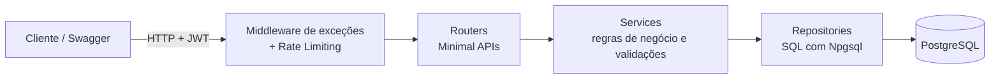
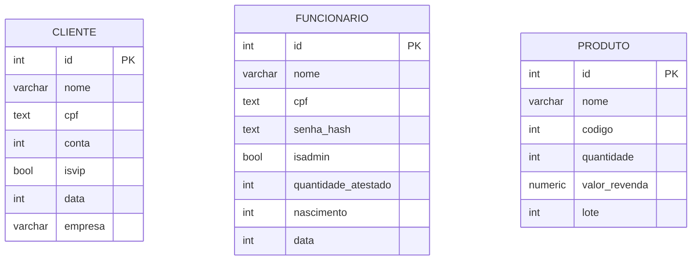

<div align="center">

# Sistema de Gestão com .NET

**API REST assíncrona para gestão de clientes, funcionários e estoque**
Autenticação JWT · RBAC · PostgreSQL · Docker · Deploy em produção

[](https://github.com/Daniel-X2/Sistema-de-Gestao-com-DOTNET/actions/workflows/desenvolvimento.yaml)


[**API em produção (Swagger)**](https://api-gestao-dotnet.onrender.com) · [**Vídeo de demonstração**](https://youtu.be/g3xyDaQyCmI)

</div>

---

## Sumário

- [Visão geral](#visão-geral)
- [Demonstração](#demonstração)
- [Destaques técnicos](#destaques-técnicos)
- [Tecnologias](#tecnologias)
- [Arquitetura](#arquitetura)
- [Estrutura do projeto](#estrutura-do-projeto)
- [Modelo de dados](#modelo-de-dados)
- [Funcionalidades](#funcionalidades)
- [Endpoints](#endpoints)
- [Tratamento de erros](#tratamento-de-erros)
- [Logs](#logs)
- [Testes](#testes)
- [Desempenho em produção](#desempenho-em-produção)
- [Como executar](#como-executar)
- [Deploy](#deploy)
- [Autor](#autor)

---

## Visão geral

API REST construída com **ASP.NET Core (Minimal APIs)** para gerenciar **clientes**, **funcionários** e **produtos/estoque**, com painel de estatísticas para dashboard. O projeto prioriza **separação de responsabilidades**, **segurança** e **observabilidade**, e está rodando em produção no **Render** com banco **PostgreSQL hospedado no Supabase**.

A documentação interativa (**Swagger**) fica na raiz da URL: basta fazer login com a credencial de demonstração, copiar o token e testar os endpoints protegidos direto pelo navegador.

## Demonstração

| Recurso | Link |
|---|---|
| API em produção + Swagger | https://api-gestao-dotnet.onrender.com |
| Vídeo: autenticação JWT e endpoints protegidos | https://youtu.be/g3xyDaQyCmI |

> Se a instância estiver em repouso, a primeira requisição pode levar alguns segundos (~3 s) para "acordar" o serviço. Depois disso, o login responde em dezenas de milissegundos (veja [Desempenho](#desempenho-em-produção)).

**Credencial de demonstração** (protegida: não pode ser removida nem alterada pela API):

```json
{
  "cpf": "78069320036",
  "senha": "123"
}
```

**Como testar em 30 segundos:**

1. Abra o [Swagger](https://api-gestao-dotnet.onrender.com)
2. Execute `POST /funcionario/login` com a credencial acima
3. Clique em **Authorize** e cole o token retornado
4. Explore os endpoints de clientes, produtos, estoque e dashboard

## Destaques técnicos

- **Arquitetura em camadas**: rotas → serviços → repositórios, com DTOs e exceções de domínio.
- **Autenticação JWT** com **RBAC** (roles `Admin` e `User`) e senhas com **BCrypt**.
- **Rate limiting** por IP para proteger contra abuso.
- **Middleware global de exceções**: respostas JSON padronizadas e status HTTP coerentes.
- **Logs estruturados** com Serilog (console + arquivo com rotação diária).
- **Validações de domínio**: CPF (algoritmo próprio), nome, conta, código, lote, quantidade e ano de nascimento.
- **Atualização parcial**: campos inválidos mantêm o valor anterior e são devolvidos na resposta.
- **Paginação** em todas as listagens.
- **Testes unitários** (xUnit, Moq, Bogus) e **testes de carga** (Locust).
- **CI** com GitHub Actions e **Docker** multi-stage com usuário não-root.
- **Deploy em produção** (Render + Supabase), configurado por variáveis de ambiente, com região escolhida a partir de medições de latência e monitoramento contínuo.

## Tecnologias

| Categoria | Tecnologia |
|---|---|
| Plataforma | .NET / ASP.NET Core (Minimal APIs) |
| Banco de dados | PostgreSQL (Supabase em produção) |
| Acesso a dados | ADO.NET com Npgsql |
| Autenticação | JWT Bearer + RBAC (Admin/User) |
| Segurança | BCrypt, Rate Limiting |
| Logs | Serilog (console + arquivo rotativo diário) |
| Configuração | DotNetEnv (variáveis de ambiente via `.env`) |
| Testes | xUnit, Moq, Bogus |
| Testes de carga | Locust |
| Infraestrutura | Docker, Docker Compose, GitHub Actions |
| Hospedagem | Render (API) + Supabase (PostgreSQL) |
| Padrões | Injeção de Dependência, Repository, Service Layer, Middleware |

## Arquitetura



Cada camada tem uma responsabilidade clara:

- **Routers**: definem endpoints, autorização e contrato HTTP.
- **Services**: concentram regras de negócio e validações.
- **Repositories**: isolam as queries SQL e o acesso ao banco.
- **Middleware**: captura exceções de qualquer camada e as converte em respostas padronizadas.

## Estrutura do projeto

```
├── .github/workflows/          # Pipeline de CI (GitHub Actions)
│
├── Api/                        # Ponto de entrada, rotas e middleware
│   ├── Application/
│   │   ├── Routers/            # Endpoints (Client, Funcionario, Product, Dashboard)
│   │   └── middleware/         # Tratamento centralizado de exceções
│   ├── Auth/                   # TokenService (JWT) e modelo de usuário
│   ├── Crypt/                  # BCrypt (hash e verificação de senha)
│   └── Program.cs
│
├── Api.Core/                   # Lógica de negócio e acesso a dados
│   └── Application/
│       ├── dto/                # DTOs (Client, Funcionario, Produto, Dashboard)
│       ├── repository/         # Repositórios com queries SQL
│       ├── service/            # Regras de negócio e validações
│       ├── utils/              # Conexão, DI (AddScope), Validation
│       └── CustomException/    # Exceções personalizadas
│
├── Api.Test/                   # Testes unitários
│   ├── dados.cs                # Geração de dados com Bogus
│   ├── TestServiceClient.cs
│   ├── TestServiceFuncionario.cs
│   ├── TestServiceProduct.cs
│   └── TestUtils.cs
│
├── Compose/                    # Docker Compose geral (API + PostgreSQL)
│   ├── docker-compose.yml
│   └── sql.sql                 # Script de inicialização do banco
│
├── Teste Local/                # Docker Compose só do banco, para rodar a API localmente
│
├── Dockerfile                  # Imagem da API (multi-stage, usuário não-root)
├── Dockerfile_db               # Imagem do PostgreSQL
└── Api.sln
```

## Modelo de dados



O script `Compose/sql.sql` cria as tabelas e insere dois registros iniciais: o funcionário administrador de demonstração e um cliente de exemplo.

## Funcionalidades

### Autenticação e autorização
- Login via **CPF + senha** com geração de token **JWT**.
- Roles `Admin` (acesso total, incluindo listagem de funcionários) e `User` (acesso restrito).
- Senhas armazenadas com **BCrypt**.
- **Rate limiting**: máximo de 5 requisições por minuto por IP.
- **Credencial padrão protegida**: o usuário de demonstração (`id = 1`) não pode ser excluído nem atualizado.

### Clientes
- Cadastro com validação de CPF, conta e nome.
- Atualização parcial: campos inválidos mantêm o valor anterior e são listados na resposta.
- Listagem paginada, contagem total de clientes e remoção por ID.
- Suporte à marcação de cliente VIP.

### Funcionários
- Cadastro com validação de CPF, nome e ano de nascimento (18–85 anos).
- Senha convertida em hash BCrypt antes de ser persistida.
- Controle de atestados e privilégios administrativos.
- CRUD completo; listagem restrita a `Admin`.

### Produtos e estoque
- Cadastro com validação de código, lote, quantidade e valor de revenda.
- Consulta de estoque (nome e quantidade) e valor bruto por produto.
- Atualização parcial: campos inválidos mantêm o valor anterior.
- CRUD completo com listagem paginada.

### Dashboard
- Endpoint de estatísticas gerais consolidadas, pronto para alimentar um painel de front-end.

## Endpoints

Todos os endpoints, exceto o login, exigem token JWT no header `Authorization: Bearer <token>`.

### Autenticação

| Método | Rota | Acesso | Descrição |
|---|---|---|---|
| POST | `/funcionario/login` | Público | Autentica por CPF e senha e gera o token JWT |

### Clientes

| Método | Rota | Acesso | Descrição |
|---|---|---|---|
| GET | `/client/get/` | Autenticado | Lista clientes (paginado) |
| GET | `/client/quantidade` | Autenticado | Retorna a quantidade de clientes |
| POST | `/client/add/` | Autenticado | Adiciona um cliente |
| PUT | `/client/update/{id}/` | Autenticado | Atualiza um cliente (parcial) |
| DELETE | `/client/delete/{id}` | Autenticado | Remove um cliente |

### Funcionários

| Método | Rota | Acesso | Descrição |
|---|---|---|---|
| GET | `/funcionario/get` | **Admin** | Lista funcionários (paginado) |
| GET | `/funcionario/get/{id}` | Autenticado | Busca funcionário por ID |
| POST | `/funcionario/add/` | Autenticado | Adiciona um funcionário |
| PUT | `/funcionario/update/{id}/` | Autenticado | Atualiza um funcionário |
| DELETE | `/funcionario/delete/{id}` | Autenticado | Remove um funcionário |

### Produtos e estoque

| Método | Rota | Acesso | Descrição |
|---|---|---|---|
| GET | `/product/get` | Autenticado | Lista produtos (paginado) |
| GET | `/product/get/{id}` | Autenticado | Busca produto por ID |
| GET | `/estoque/get` | Autenticado | Consulta estoque: nome e quantidade (paginado) |
| GET | `/estoque/valorBruto` | Autenticado | Lista o valor bruto dos produtos |
| POST | `/product/add` | Autenticado | Adiciona um produto |
| PUT | `/product/update/{id}/` | Autenticado | Atualiza um produto |
| DELETE | `/product/delete/{id}` | Autenticado | Remove um produto |

### Dashboard

| Método | Rota | Acesso | Descrição |
|---|---|---|---|
| GET | `/dashboard/stats` | Autenticado | Estatísticas gerais para o dashboard |

### Paginação

As listagens aceitam `page` (padrão `1`) e `limit` (padrão `100`):

```
GET /client/get?page=1&limit=10
GET /funcionario/get?page=1&limit=10
GET /product/get?page=1&limit=10
GET /estoque/get?page=1&limit=10
```

## Tratamento de erros

Um middleware centralizado captura as exceções, registra no Serilog e devolve respostas JSON padronizadas:

| Exceção | Status HTTP |
|---|---|
| `InvalidCpfException` | 422 Unprocessable Entity |
| `InvalidNameException` | 422 Unprocessable Entity |
| `InvalidAccountException` | 422 Unprocessable Entity |
| `InvalidCodeException` | 422 Unprocessable Entity |
| `NegativeNumericException` | 422 Unprocessable Entity |
| `ReturnDataIsEmpty` | 400 Bad Request |
| `InvalidIdException` | 400 Bad Request |
| `InvalidNascimentoException` | 400 Bad Request |
| `InvalidLoteException` | 400 Bad Request |
| `ErroAddToDatabaseException` | 400 Bad Request |
| `InvalidPassword` | 401 Unauthorized |
| `InvalidConnection` | 500 Internal Server Error |
| `NpgsqlException` (erro de banco) | 500 Internal Server Error |
| Qualquer outra exceção | 500 Internal Server Error |

Exemplo de resposta:

```json
{
  "erro": "O Cpf inserido e invalido",
  "details": "Verifique o cpf e tente novamente"
}
```

## Logs

Gerados automaticamente via **Serilog** em dois destinos:

- **Console**: visível em tempo real.
- **Arquivo**: `./Logs/logs.txt` com rotação diária.

Cada requisição é registrada com método HTTP, rota, status code e tempo de resposta.

## Testes

### Testes unitários

Cobrem a camada de serviço com mocks dos repositórios, sem necessidade de banco de dados real.

- **xUnit**: execução dos testes
- **Moq**: mock das interfaces de repositório
- **Bogus**: geração de dados falsos

```bash
dotnet test
```

### Testes de carga

Realizados com **Locust**, simulando usuários simultâneos com operações mistas de leitura e escrita (GET, POST, PUT, DELETE).

| Usuários | Requisições | Req/s | Tempo médio | Mediana |
|---|---|---|---|---|
| 10 | 1.572 | 4,9 | 9,8 ms | 4 ms |
| 50 | 8.346 | 23,2 | 7,4 ms | 3 ms |

Os endpoints de leitura mantiveram mediana de **3 ms** nos dois cenários, com **zero falhas**.

## Desempenho em produção

Medições feitas na API publicada (Render, Virginia/EUA) com o banco no Supabase (US East), com a instância já em funcionamento, sem contar o primeiro acesso após a inicialização. A infraestrutura foi ajustada com base nesses números.

> Os valores abaixo são registros de testes feitos em momentos diferentes, **não de um benchmark padronizado**. Servem para mostrar a ordem de grandeza e a evolução do projeto.

### Login (`POST /funcionario/login`)

O login é o endpoint mais pesado, pois executa validação de CPF, consulta ao banco e verificação de hash BCrypt.

| Cenário | Resultado |
|---|---|
| Primeiros acessos após a inicialização | ~2,6 a 3,2 s |
| Acessos seguintes, antes das otimizações | média de 46,46 ms |
| Após otimizar o utilitário de CPF (9 acessos) | **média de 29,2 ms** |
| Mediana / mínimo / máximo (mesmo teste) | 12,13 ms / 5,61 ms / 74,38 ms |

### Escolha da região

Comparação entre hospedar a API em Virginia ou em Oregon, com o banco em US East:

| Endpoint | Virginia | Oregon |
|---|---:|---:|
| `GET` funcionários | **44,80 ms** | 74,56 ms |
| `GET` funcionário por ID | **49,61 ms** | 77,82 ms |

Com a API na mesma costa do banco, o tempo de resposta caiu de forma consistente, e por isso a API roda em **Virginia**.

### Monitoramento (UptimeRobot)

| Métrica | Antes | Atual |
|---|---:|---:|
| Tempo de resposta médio | 148 ms | **65 ms** |
| Mínimo / máximo | n/d | 63 ms / 66 ms |

### Outros pontos de referência

| Medição | Resultado |
|---|---|
| Swagger, primeiro acesso após a inicialização | ~750 a 809 ms |
| Swagger, acessos seguintes | ~32 ms |
| `index.html`, acessos seguintes | ~1 a 1,4 ms |
| Consulta ao banco, local (medição anterior) | ~5 ms |
| Consulta ao banco, nuvem (medição anterior) | ~236 a 243 ms |

### O que foi feito para melhorar

- Otimização do utilitário de validação de CPF.
- Remoção de verificações redundantes.
- Testes de isolamento, removendo temporariamente a validação de CPF e o BCrypt, para identificar quanto cada etapa pesava no tempo do login.
- Reposicionamento da API na mesma região do banco.

## Como executar

### Pré-requisitos

- [.NET SDK](https://dotnet.microsoft.com/download)
- [Docker](https://www.docker.com/) e Docker Compose

### 1. Variáveis de ambiente

Crie um arquivo `.env` com as variáveis abaixo:

```env
DB_CONNECTION=Host=postgres_db;Database=postgres;Username=postgres;Password=senha
POSTGRES_PASSWORD=senha
JWT_KEY=sua_chave_secreta
JWT_ISSUER=MinhaApi
JWT_AUDIENCE=MeuClient
```

| Variável | Descrição |
|---|---|
| `DB_CONNECTION` | String de conexão com o PostgreSQL |
| `POSTGRES_PASSWORD` | Senha do PostgreSQL (usada pelo container do banco) |
| `JWT_KEY` | Chave secreta para assinar os tokens |
| `JWT_ISSUER` | Emissor do token |
| `JWT_AUDIENCE` | Audiência do token |

### 2. Docker Compose completo (recomendado)

A pasta `Compose/` sobe **API + PostgreSQL** juntos. Crie o `.env` dentro dela e execute:

```bash
cd Compose
docker-compose up -d
```

- API disponível em `http://localhost:5153` (Swagger na raiz)
- PostgreSQL exposto na porta `5433` do host
- O banco é inicializado automaticamente com as tabelas e o funcionário administrador padrão

### 3. Execução local (API via `dotnet run` + banco em container)

A pasta `Teste Local/` contém um compose **apenas com o banco de dados**, ideal para desenvolver e depurar a API localmente.

```bash
# 1) Suba somente o PostgreSQL
cd "Teste Local"
docker-compose up -d

# 2) Em outro terminal, crie o .env dentro de Api/ apontando DB_CONNECTION
# para o host/porta do banco (ex.: Host=localhost;Port=<porta do compose>;...)
cd ../Api
dotnet run
```

> No modo local, use `Host=localhost` (e a porta exposta pelo compose) em `DB_CONNECTION`. O host `postgres_db` só existe dentro da rede do Docker Compose.

## Deploy

| Componente | Serviço |
|---|---|
| API (container Docker) | [Render](https://api-gestao-dotnet.onrender.com), região Virginia (EUA) |
| Banco de dados | PostgreSQL gerenciado no [Supabase](https://supabase.com), região US East |
| Monitoramento | UptimeRobot |

A mesma imagem usada localmente roda em produção; a diferença está apenas nas **variáveis de ambiente** (`DB_CONNECTION` apontando para o Supabase e os segredos JWT configurados no painel do Render), sem alterações de código.

## Autor

**Daniel** · [@Daniel-X2](https://github.com/Daniel-X2)

Projeto licenciado sob a [Licença MIT](LICENSE). Se ele foi útil ou interessante, deixe uma estrela no repositório.
